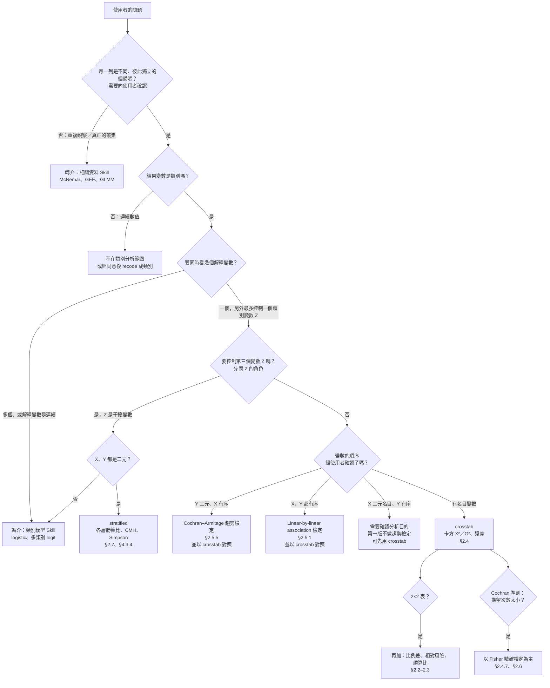

# 選方法的決策樹

階段 3 用。由上往下回答問題；每一個出口都附上教科書節號（Agresti 3e）。每個候選方法再依 `checklist.md` 標示 ✅／⚠️／❌。

## 文字版（給沒有 mermaid 的環境）

1. **資料獨立嗎？**（需要向使用者確認）前後測、同一 outcome 多個時間點、同一受試者重複列入 → 不獨立 → 轉介相關資料 Skill（§1.1.3、Ch.8–10）。學校、醫院等群體：有真正的群內相關就轉介；只是一般的類別變數、控制後個體可視為獨立，才可以拿來分層。
2. **結果是類別嗎？** 是連續數值 → 不做；使用者同意的話可以 `recode` 成類別（會損失資訊，並提醒切點的影響）。
3. **幾個解釋變數？** 多個、或解釋變數是連續 → 轉介類別模型 Skill（Ch.4–6）。
4. **只有 X、Y 兩個類別變數**（順序都要經使用者確認，數字代碼不代表有順序）：
   - Y 二元、X 有序 → **Cochran–Armitage 趨勢檢定**（`trend`，§2.5.5）。
   - X、Y 都有序 → **linear-by-linear association 檢定**（`trend`，§2.5.1）。
   - 兩種都要和忽略順序的 `crosstab` 對照（§2.5.3）；類別間距不等時確認分數（§2.5.4）。
   - X 二元名目、Y 有序 → **需要確認分析目的**，第一版不做趨勢檢定，可先用 `crosstab`。
   - 有名目變數（3 類以上） → **`crosstab`**（§2.4）。**不能**用 `trend`（名目沒有分數）。
   - 2×2 → `crosstab` 會另外給比例差、相對風險、勝算比（§2.2–2.3）。
   - 期望次數太小（Cochran 準則，見 `checklist.md` 第 1 條） → 以 Fisher 精確檢定為主（§2.4.7、§2.6）。
5. **再控制一個類別變數 Z：** 先問 Z 的角色（干擾變數才分層，中介變數不控制）。X、Y 都是二元 → **`stratified`**（§2.7、§4.3.4）；否則轉介類別模型 Skill。

## 研究設計會改變能報告的效果量（需要向使用者確認）

| 設計 | 例子 | 能報告 |
|---|---|---|
| 追蹤（cohort）、隨機實驗 | 追蹤吸菸者、隨機分派治療 | 比例差、相對風險、勝算比 |
| 橫斷調查 | 同一時間的問卷 | 比例差、相對風險、勝算比，但比例要說成「比例／盛行率」，不是「發生風險」 |
| case-control | 先找病人和對照組，再回頭問是否吸菸 | **只有勝算比**（§2.3.5） |
| 便利樣本 | 網路問卷 | 可以計算，但結論限於這群樣本 |

## 常見誤用（使用者指定時要攔下來）

| 使用者要求 | 問題 | 改用 |
|---|---|---|
| 前後測資料做卡方 | 同一人兩次不獨立 | McNemar（相關資料 Skill，§8.1） |
| 名目變數做趨勢檢定 | 名目類別沒有順序與分數 | crosstab（§2.5.5） |
| 性別 × 滿意度做趨勢檢定 | 二元名目變數不能因為可以編成 0/1 就當成有序 | 先確認分析目的；可用 crosstab |
| 有序變數只做卡方 | 浪費順序資訊、檢定力較低 | Cochran–Armitage 或 linear-by-linear（§2.5.3） |
| 說「勝算比 2 = 機率兩倍」 | 勝算比 ≠ 相對風險，除非比例很小 | 同時報告相對風險（§2.3.4） |
| 看到第三個變數就跑 CMH | 中介變數不應控制 | 先問變數的角色 |
| 只看合併表下結論 | 可能有 Simpson 悖論 | stratified（§2.7.3） |
