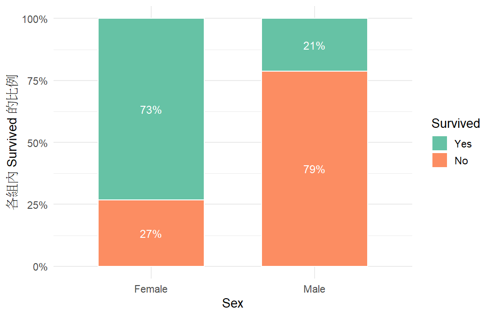
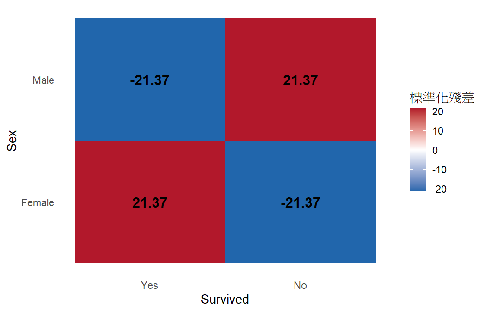

# 分析報告：鐵達尼號上女性的存活率比男性高嗎？

- 資料檔：`01_crosstab_titanic.csv`
- 方法：列聯表分析：卡方獨立性檢定（chi-squared test of independence）（Agresti §2.1–2.4, §2.6）
- 資料結構：independent
- 選擇理由：兩個二元變數、每一列是不同的乘客，用列聯表與卡方檢定

## 次數表

|   | Yes | No |
|---|---|---|
| Female | 344 | 126 |
| Male | 367 | 1364 |

## 結果

- 樣本數 n = 2201；Sex 有 2 類，Survived 有 2 類。
- Pearson 卡方 X² = 456.87（df = 1），P = < 0.001；概似比 G² = 434.47。
- 獨立假設下的期望次數最小為 151.83；小於 5 的格子 0 / 4。
- Fisher 精確檢定雙尾 P = < 0.001。
- 2×2 表四格的標準化殘差絕對值相同，以其中一格為代表：Sex=Female、Survived=Yes（21.37，實際次數比獨立時預期的多）。
- Survived=Yes 的比例：Female 組為 0.732（344/470），Male 組為 0.212（367/1731）。
- 比例差（Female − Male）= 0.5199，95% CI [0.4739, 0.5626]。
- 相對風險 RR（Female / Male）= 3.45，95% CI [3.10, 3.84]。
- 勝算比 OR（Female 相對於 Male，Survived=Yes 的勝算）= 10.15，95% CI [8.03, 12.83]。

## 檢定

| test | statistic | df | p_value | book_ref |
|---|---|---|---|---|
| Pearson X2 | 456.8742 | 1.0000 | 2.302e-101 | §2.4.3 |
| Likelihood-ratio G2 | 434.4688 | 1.0000 | 1.731e-96 | §2.4.3 |
| Fisher exact (two-sided) | — | — | 2.691e-96 | §2.6 |

## 效果量與信賴區間

| measure | estimate | lower | upper | ci_method | book_ref |
|---|---|---|---|---|---|
| difference of proportions | 0.5199 | 0.4739 | 0.5626 | score | §2.2.2 |
| relative risk | 3.4522 | 3.1038 | 3.8374 | score | §2.2.3 |
| odds ratio | 10.1470 | 8.0280 | 12.8252 | score | §2.3.3 |

## 注意事項

- 比例不算小，勝算比不能當成相對風險來解釋（「幾倍的機率」要看 RR）。（Agresti §2.3.4）

## 圖

> 卡方檢定只回答「有沒有證據顯示有關聯」，不代表關聯有多強；強度要看比例、勝算比與殘差（§2.4.7）。
