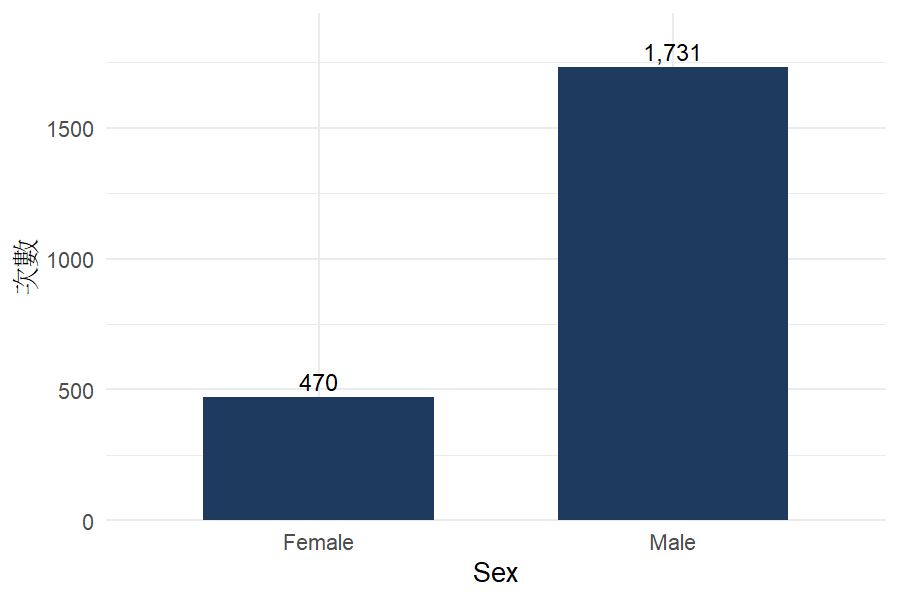
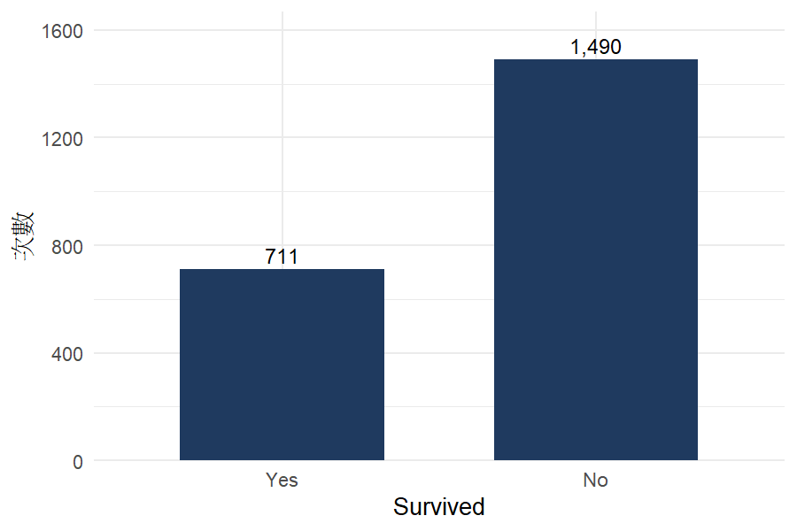

# 初步檢視：01_crosstab_titanic.csv

- 使用的觀察值：2,201（因缺失刪除 0）
- 最小的一組：Sex = Female，470 個
- 獨立假設下的最小期望次數：151.83；期望次數 < 5 的格子：0 / 4；次數為 0 的格子：0

## 次數表

| Sex \ Survived | Yes | No | 合計 |
|---|---|---|---|
| Female | 344 | 126 | 470 |
| Male | 367 | 1,364 | 1,731 |

## 圖

