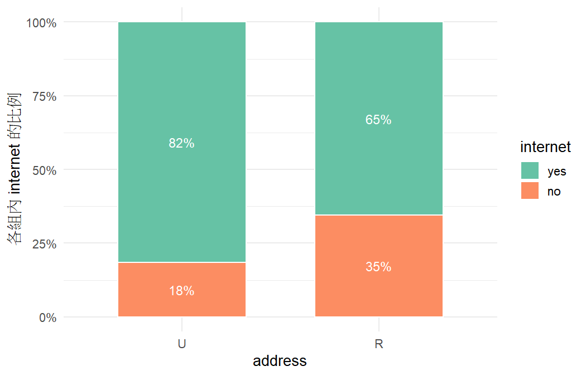
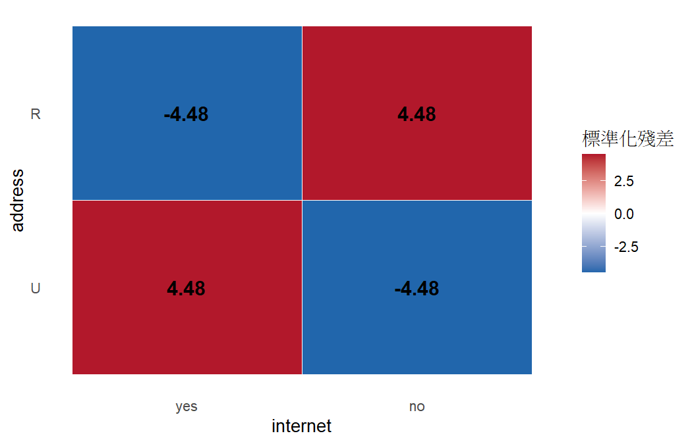

# 分析報告：住在都市或鄉下，和家裡有沒有網路有關嗎？

- 資料檔：`student-por.csv`
- 方法：列聯表分析：卡方獨立性檢定（chi-squared test of independence）（Agresti §2.1–2.4, §2.6）
- 資料結構：independent
- 選擇理由：兩個不同的二元變數、每一列是不同的學生，用列聯表與卡方檢定

## 次數表

|   | yes | no |
|---|---|---|
| U | 369 | 83 |
| R | 129 | 68 |

## 結果

- 樣本數 n = 649；address 有 2 類，internet 有 2 類。
- Pearson 卡方 X² = 20.06（df = 1），P = < 0.001；概似比 G² = 19.16。
- 獨立假設下的期望次數最小為 45.84；小於 5 的格子 0 / 4。
- Fisher 精確檢定雙尾 P = < 0.001。
- 2×2 表四格的標準化殘差絕對值相同，以其中一格為代表：address=U、internet=yes（4.48，實際次數比獨立時預期的多）。
- internet=yes 的比例：U 組為 0.816（369/452），R 組為 0.655（129/197）。
- 比例差（U − R）= 0.1615，95% CI [0.0881, 0.2384]。
- 相對風險 RR（U / R）= 1.25，95% CI [1.12, 1.40]。
- 勝算比 OR（U 相對於 R，internet=yes 的勝算）= 2.34，95% CI [1.61, 3.42]。

## 檢定

| test | statistic | df | p_value | book_ref |
|---|---|---|---|---|
| Pearson X2 | 20.0564 | 1.0000 | 7.519e-06 | §2.4.3 |
| Likelihood-ratio G2 | 19.1646 | 1.0000 | 1.199e-05 | §2.4.3 |
| Fisher exact (two-sided) | — | — | 1.265e-05 | §2.6 |

## 效果量與信賴區間

| measure | estimate | lower | upper | ci_method | book_ref |
|---|---|---|---|---|---|
| difference of proportions | 0.1615 | 0.0881 | 0.2384 | score | §2.2.2 |
| relative risk | 1.2467 | 1.1243 | 1.4032 | score | §2.2.3 |
| odds ratio | 2.3435 | 1.6056 | 3.4206 | score | §2.3.3 |

## 注意事項

- 比例不算小，勝算比不能當成相對風險來解釋（「幾倍的機率」要看 RR）。（Agresti §2.3.4）

## 圖

> 卡方檢定只回答「有沒有證據顯示有關聯」，不代表關聯有多強；強度要看比例、勝算比與殘差（§2.4.7）。
