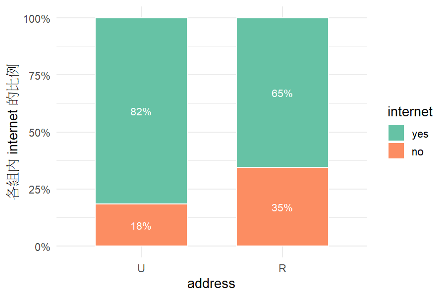

# 分析報告：住在都市或鄉下，和家裡有沒有網路有關嗎？

- 資料檔：`student-por.csv`
- 方法：列聯表分析：卡方獨立性檢定（chi-squared test of independence）（Agresti §2.1–2.4, §2.6）
- 資料結構：independent
- 選擇理由：兩個不同的二元變數、每一列是不同的學生，用列聯表與卡方檢定

## 次數表

|   | yes | no |
|---|---|---|
| U | 369 | 83 |
| R | 129 | 68 |

## 結果

- 樣本數 n = 649；address 有 2 類，internet 有 2 類。
- Pearson 卡方 X² = 20.06（df = 1），P = < 0.001；概似比 G² = 19.16。
- 獨立假設下的期望次數最小為 45.84；小於 5 的格子 0 / 4。
- Fisher 精確檢定雙尾 P = < 0.001。
- 2×2 表四格的標準化殘差絕對值相同，以其中一格為代表：address=U、internet=yes（4.48，實際次數比獨立時預期的多）。
- internet=yes 的比例：U 組為 0.816（369/452），R 組為 0.655（129/197）。
- 比例差（U − R）= 0.1615，95% CI [0.0881, 0.2384]。
- 相對風險 RR（U / R）= 1.25，95% CI [1.12, 1.40]。
- 勝算比 OR（U 相對於 R，internet=yes 的勝算）= 2.34，95% CI [1.61, 3.42]。

## 檢定

| test | statistic | df | p_value | book_ref |
|---|---|---|---|---|
| Pearson X2 | 20.0564 | 1.0000 | 7.519e-06 | §2.4.3 |
| Likelihood-ratio G2 | 19.1646 | 1.0000 | 1.199e-05 | §2.4.3 |
| Fisher exact (two-sided) | — | — | 1.265e-05 | §2.6 |

## 效果量與信賴區間

| measure | estimate | lower | upper | ci_method | book_ref |
|---|---|---|---|---|---|
| difference of proportions | 0.1615 | 0.0881 | 0.2384 | score | §2.2.2 |
| relative risk | 1.2467 | 1.1243 | 1.4032 | score | §2.2.3 |
| odds ratio | 2.3435 | 1.6056 | 3.4206 | score | §2.3.3 |

## 注意事項

- 比例不算小，勝算比不能當成相對風險來解釋（「幾倍的機率」要看 RR）。（Agresti §2.3.4）

## 圖

各組比例的圖在階段 2（`relation.png`），這裡不重畫。



> 卡方檢定只回答「有沒有證據顯示有關聯」，不代表關聯有多強；強度要看比例、勝算比與殘差（§2.4.7）。

## R 程式碼

重新計算上面所有數字和圖的 R 程式碼，只需要 CRAN 套件。把它和資料檔 `student-por.csv` 放在同一個資料夾執行；第一次使用先安裝套件：`install.packages(c("readr", "readxl", "ggplot2", "scales", "PropCIs"))`。

```r
library(ggplot2)
data_file <- "student-por.csv"   # 資料檔名：檔名不一樣時改這一行
if (!file.exists(data_file)) stop("找不到資料檔 ", data_file, "：請把它和這個檔案放在同一個資料夾，或把上一行改成資料檔的完整路徑。")
df <- as.data.frame(readr::read_delim(data_file, delim = ";",
  locale = readr::locale(encoding = "UTF-8"), show_col_types = FALSE))

# 類別順序（沒有指定的變數依代碼排序）
df[["address"]] <- factor(df[["address"]], levels = c("U", "R"))
df[["internet"]] <- factor(df[["internet"]], levels = c("yes", "no"))
# 排除分析變數有缺失的列（有缺失一律報告；≥ 5% 要提醒）
vars <- c("address", "internet")
miss <- !complete.cases(df[vars])
c(排除筆數 = sum(miss), 比例 = mean(miss))
df <- df[!miss, ]
df[vars] <- droplevels(df[vars])   # 沒有觀察值的類別從分析中移除

tab <- xtabs(~ `address` + `internet`, data = df)   # 列 = 解釋變數 X，欄 = 結果變數 Y
addmargins(tab)
round(prop.table(tab, 1), 4)           # 各組（列）的條件比例

ct <- chisq.test(tab, correct = FALSE)
ct                                     # Pearson X²
G2 <- 2 * sum(ifelse(tab > 0, tab * log(tab / ct$expected), 0))
c(G2 = G2, df = unname(ct$parameter), p = pchisq(G2, ct$parameter, lower.tail = FALSE))
round(ct$expected, 2)                  # 期望次數
c(最小期望次數 = min(ct$expected), 小於5的格數 = sum(ct$expected < 5))
round(ct$stdres, 2)                    # 標準化殘差：|r| > 2 的格子明顯偏離獨立（§2.4.5）

fisher.test(tab)                       # 雙尾

s <- "yes"                       # 「成功」的類別
y1 <- tab[1, s]; n1 <- sum(tab[1, ])
y2 <- tab[2, s]; n2 <- sum(tab[2, ])
p1 <- y1 / n1; p2 <- y2 / n2
ci <- rbind(PropCIs::diffscoreci(y1, n1, y2, n2, conf.level = 0.95)$conf.int,
            PropCIs::riskscoreci(y1, n1, y2, n2, conf.level = 0.95)$conf.int,
            PropCIs::orscoreci(y1, n1, y2, n2, conf.level = 0.95)$conf.int)
data.frame(量數 = c("比例差", "相對風險", "勝算比"),
           估計值 = c(p1 - p2, p1 / p2, (y1 * (n2 - y2)) / ((n1 - y1) * y2)),
           下限 = ci[, 1], 上限 = ci[, 2])

ggplot(as.data.frame(prop.table(tab, 1)), aes(x = .data[["address"]], y = Freq, fill = .data[["internet"]])) +
  geom_col() +
  scale_y_continuous(labels = scales::percent) +
  labs(y = "比例") +
  theme_minimal()
```
