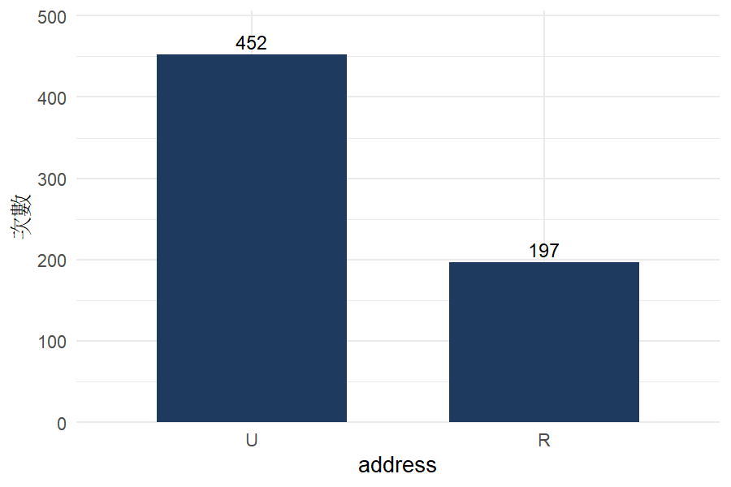
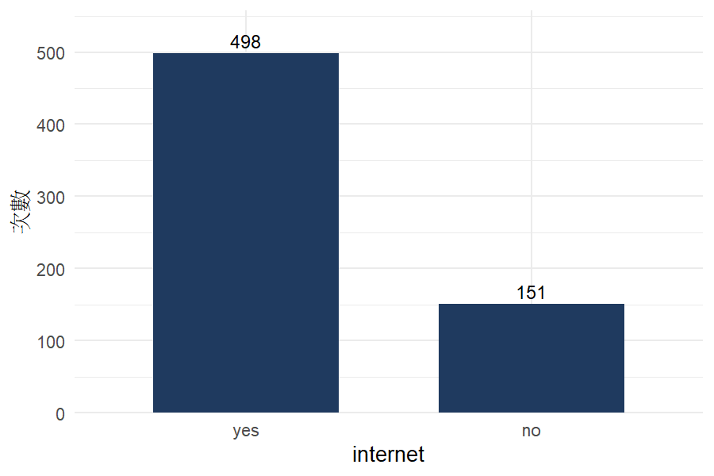

# 初步檢視：student-por.csv

- 使用的觀察值：649（因缺失刪除 0）
- 最小的一組：address = R，197 個
- 獨立假設下的最小期望次數：45.84；期望次數 < 5 的格子：0 / 4；次數為 0 的格子：0

## 次數表

| address \ internet | yes | no | 合計 |
|---|---|---|---|
| U | 369 | 83 | 452 |
| R | 129 | 68 | 197 |

## 圖

