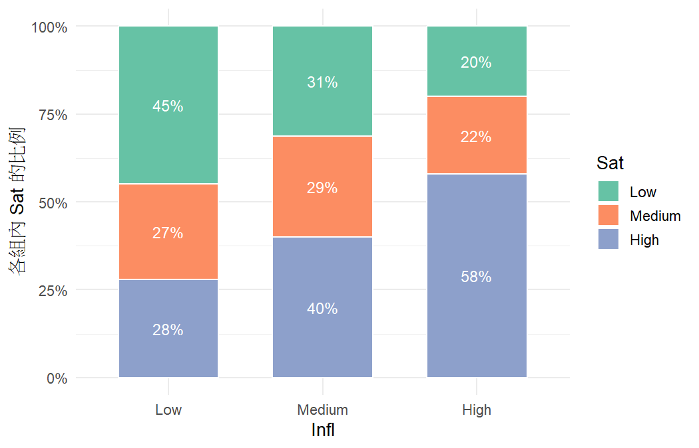

# 分析報告：住戶對管理的影響力越大，居住滿意度越高嗎？

- 資料檔：`02_trend_housing.csv`
- 方法：Linear-by-linear association 檢定（M²）（Agresti §2.5）
- 資料結構：independent
- 選擇理由：兩個有序變數，用 linear-by-linear association 檢定（§2.5.1）

## 次數表

|   | Low | Medium | High |
|---|---|---|---|
| Low | 282 | 170 | 175 |
| Medium | 206 | 189 | 264 |
| High | 79 | 87 | 229 |

## 結果

- 樣本數 n = 1681；Infl 有 3 類，Sat 有 3 類。
- 方法：Linear-by-linear association 檢定（Infl 與 Sat 都是有序變數）。
- Infl 的分數：1, 2, 3；Sat 的分數：1, 2, 3。
- 相關係數 R = 0.2456；M² = (n − 1)R² = 101.37（df = 1），P = < 0.001。
- 單尾檢定（Infl 越高，Sat 越高）：M = 10.07，P = < 0.001。
- 對照：忽略順序的卡方檢定 X² = 106.18（df = 4），P = < 0.001。有真正的線性趨勢時，M² 只用 1 個自由度，通常檢定力較高（§2.5.3）。
- 使用等距分數。若類別間距離不相等，應依實際意義設定分數並做敏感度分析（§2.5.4）。

## 檢定

| test | statistic | df | p_value | book_ref |
|---|---|---|---|---|
| Linear-by-linear association (M2) | 101.3675 | 1.0000 | 7.641e-24 | §2.5.1 |
| Pearson X2 (ignores order) | 106.1751 | 4.0000 | 4.759e-22 | §2.4.3 |

## 圖

> M² 只檢定「線性趨勢」；R 的大小受邊際分配影響，不適合單獨描述關聯強度（§2.5.2）。
