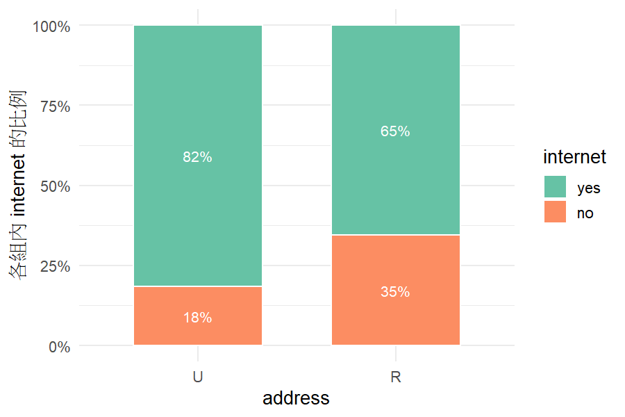

```{r}
#| include: false
library(jsonlite)
skill_dir <- "categorical-association"
scripts <- file.path(skill_dir, "scripts")
for (f in list.files(file.path(skill_dir, "R"), pattern = "\\.R$", full.names = TRUE)) source(f)
out_root <- "dev/demo/example-output"

# Run one of the Skill's scripts exactly as Claude would.
run_script <- function(script, args) {
  system2("Rscript", c(shQuote(file.path(scripts, script)), shQuote(args)), stdout = FALSE, stderr = FALSE)
}
run_skill <- function(spec, data, out = tempfile("run-")) {
  spec_file <- tempfile(fileext = ".json")
  writeLines(toJSON(spec, auto_unbox = TRUE, null = "null"), spec_file, useBytes = TRUE)
  status <- run_script("run_analysis.R", c(data, spec_file, out))
  list(status = status, out = out, json = fromJSON(file.path(out, "result.json")))
}
md_body <- function(path) sub("^#", "####", readLines(path, encoding = "UTF-8"))
ok <- function(x) if (isTRUE(x)) "✅" else "❌"
f2 <- function(x) formatC(x, format = "f", digits = 2)
```

::: {.callout-tip}
## 這一頁要回答
1. 這個 Skill **要解決什麼問題**？
2. 它**怎麼運作**？
3. 我們放進去的**知識**是什麼？它怎麼提醒使用者不能亂做？
4. **怎麼用**？做出來**合不合理**？
:::

## 要解決什麼問題？

拿到一份資料、想知道「A 和 B 有沒有關係」，真正困難的不是按下卡方檢定，而是**前面的判斷**：

- 這個變數是名目還是有序？數字 1–4 是代碼還是分數？
- 每一列彼此獨立嗎？同一個人有沒有出現兩次？
- 樣本夠不夠大？要不要控制別的變數？

直接問一般的 AI，它常常**直接套卡方、自己心算數字**，而且不會提醒限制。

::: {.callout-note}
## 目標
讓 Claude 像修過類別資料分析的助教：**先看資料、判斷能不能用、和使用者確認，再用程式算，最後用白話解釋並提醒限制**。範圍是「兩個類別變數有沒有關聯」。
:::

## Skill 是什麼？

Skill 就像交給 Claude 的**一本工作手冊加上一個工具箱**，裝在一個資料夾裡。Claude 平常不會翻開它，只有遇到「兩個類別變數有沒有關係」這類問題時才會拿出來用。

| 資料夾裡有什麼 | 白話說 |
|---|---|
| `SKILL.md` | **工作手冊**：告訴 Claude 這類問題要分幾步做、哪裡要停下來問人、結果要怎麼解釋 |
| `references/` | **參考資料**，需要時才翻：我們的注意事項清單、怎麼選方法、各方法的說明 |
| `scripts/` | **工具**：做總表、畫圖、跑分析的程式 |
| `R/` | **計算機**：所有統計數字都在這裡算，Claude 自己不算 |

手冊最上面有一段簡短的介紹，Claude 就是看這段來決定「這個問題該不該用這個 Skill」。

## 怎麼運作？五個階段、兩次停下來

```{mermaid}
flowchart LR
    U[使用者：資料] --> P1[1 資料總覽<br/>敘述統計總表]
    P1 --> Q{{停：問使用者<br/>想問什麼}}
    Q --> P2[2 依問題畫圖]
    P2 --> P3[3 對照注意事項清單<br/>✅ ⚠️ ❌]
    P3 --> STOP{{停：等使用者 OK}}
    STOP --> P4[4 程式計算<br/>畫圖、報告]
    P4 --> P5[5 白話解釋]
```

三個設計重點：

- **AI 判斷，程式計算**：Claude 不可以自己算任何數字，所有統計量都由程式算出來，Claude 只能引用。
- **資料證明不了的事一定要問人**：變數有沒有順序、每一列是不是不同的人、研究設計，只有使用者知道，所以第 1 步和第 3 步都會停下來。
- **範圍外不硬算**：超出「兩個類別變數有沒有關聯」的問題，Skill 會說明不能做，不會硬算。

## 給 Skill 的知識：注意事項清單

我們把**分析前需要注意的狀況**整理成一份注意事項清單（`references/checklist.md`），這就是我們給 Skill 的知識。第 3 步會拿資料去對照這份清單，替每個方法標示：

- ✅ **可以使用**
- ⚠️ **可以使用，但需要提醒**（說明問題與要用的方法）
- ❌ **不適合使用**（說明原因，建議其他方法或轉介）

清單上沒有的狀況，Skill 不可以自己發明標準。

```{r}
#| include: false
ck <- readLines(file.path(skill_dir, "references", "checklist.md"), encoding = "UTF-8")
section_of <- cumsum(grepl("^## [ABC]\\.", ck))
by_cat <- tapply(grepl("^### [0-9]+\\.", ck), section_of, sum)[-1]
mvp <- ck[(grep("^## MVP", ck) + 1):length(ck)]
mvp <- mvp[nzchar(mvp)]
```

| 類別 | 條數 | 例子 |
|---|---|---|
| A. Skill 可以自動從資料檢查 | `r by_cat[1]` | 期望次數太小、有 0 次數的格子、缺失值、分層後各層方向不一致 |
| B. 一定要問使用者 | `r by_cat[2]` | 同一個人測了兩次、數字代碼有沒有順序、研究設計、第三個變數的角色 |
| C. 解釋結果的提醒 | `r by_cat[3]` | P 值不等於關聯強弱、相關不等於因果、勝算比不是機率的倍數 |

### 它怎麼提醒使用者不能亂做

第一版真正會擋下來或標示的是下面 **9 條核心規則**，其他的只做文字提醒，避免第一版太複雜：

::: {.columns .rules}
::: {.column width="31%"}
**分析前一定問使用者**

1. 每一列是不是不同、彼此無關的人？不是就不做卡方，建議配對資料的方法
2. 類別有沒有順序？數字代碼不會自動當成有順序
3. 資料是怎麼收集的？例如 case-control 研究就不報相對風險
:::
::: {.column width="36%"}
**程式自動檢查**

4. 是不是整理好的次數表？確認次數欄是人數
5. 期望次數太小 → 卡方不準，改用 Fisher
6. 有次數為 0 的格子 → 不用會失效的算法
7. 有缺失值 → 報告刪了多少筆，比例高就提醒
8. 要控制第三個變數 → 先問它的角色；各層結果方向不一致時，要逐層報告
:::
::: {.column width="31%"}
**解釋結果時**

9. 一律附上關聯大小與信賴區間；不顯著寫「證據不足」而不是「沒關係」；不說「造成」；勝算比不是機率的倍數
:::
:::

<style>.rules .column { overflow-wrap: anywhere; padding-right: 0.8em; box-sizing: border-box; }</style>

::: {.callout-note collapse="true"}
## 清單是怎麼寫出來的（點開查看）
主題由組員決定（資料結構、樣本大小、變數型態、研究設計、第三個變數、結果解釋）。AI 依主題起草文字後，組員逐條修正判斷規則，例如：

- 不能只用「總樣本數小於多少」判斷，要看期望次數與表格稀疏程度（Cochran 準則）。
- 小組人數 < 10、缺失 ≥ 5% 只是**提醒**，不是不能分析的界線。
- 各層勝算比「差很多」不設任意倍率門檻，只在方向相反或同質性檢定顯著時標 ⚠️。
- 趨勢檢定分成 Cochran–Armitage（二元結果 × 有序）與 linear-by-linear association（有序 × 有序），名稱不混用；性別 × 滿意度這種二元名目 × 有序，第一版不做。
- 第一版只報 Fisher 精確檢定，不報 mid-P，避免同時給好幾種 P 值。
:::

## 怎麼用？

### 安裝

- **網頁版或桌面版**：在「設定 → 功能」開啟程式碼執行，再到「Skills」上傳 `categorical-association.zip`。詳細步驟見 repo 的 `實作教學.md`。
- **Claude Code**：安裝 R 套件（`Rscript categorical-association/scripts/install_packages.R`），把 `categorical-association` 資料夾複製到 `.claude/skills/`。

### 跟著做：要貼給 Claude 的話

開一個新對話，把 `example_data/student-por.csv` 拖進對話框，再依序貼上下面的文字；每一題開一個新對話。按框框右邊的按鈕就能複製。

::: {.panel-tabset}

#### ✅ 住家 × 網路

1. 上傳資料後貼上：

   ```{.default}
   請用 categorical-association 分析這份資料
   ```

2. 它給完總表、問想回答什麼問題時貼上：

   ```{.default}
   住在都市或鄉下，和家裡有沒有網路有關嗎？
   ```

3. 它停下來確認時貼上：

   ```{.default}
   每一列是不同的學生；成功 = yes（有網路）；不控制學校，只看這兩個變數；是橫斷調查，可以；用推薦的
   ```

#### ❌ 平日 vs 週末喝酒

1. 在 ✅ 那題的**同一個對話**接著貼上（新對話的話，先上傳資料、貼「請用 categorical-association 分析這份資料」）：

   ```{.default}
   學生平日和週末的喝酒程度一樣嗎？
   ```

2. 如果它停下來問 `Dalc`、`Walc` 是不是同一個人，再貼上：

   ```{.default}
   對，Dalc 和 Walc 是同一個學生回答的平日和週末喝酒程度
   ```

#### 練習：補習 × 讀大學 ⚠️

1. 上傳資料後貼上：

   ```{.default}
   請用 categorical-association 分析這份資料
   ```

2. 它問想回答什麼問題時貼上：

   ```{.default}
   有沒有上付費補習，和想不想讀大學有關嗎？
   ```

3. 它停下來確認時貼上：

   ```{.default}
   每一列是不同的學生；成功 = yes（想讀大學）；用推薦的
   ```

#### 練習：讀書時間

1. 上傳資料後貼上：

   ```{.default}
   請用 categorical-association 分析這份資料
   ```

2. 它問想回答什麼問題時貼上：

   ```{.default}
   每週讀書時間越長，越想讀大學嗎？
   ```

3. 它停下來確認時貼上：

   ```{.default}
   studytime 是有序的：1 < 2 < 3 < 4（數字越大讀越久）；每一列是不同的學生；成功 = yes；用推薦的
   ```

:::

<style>.panel-tabset div.sourceCode { background: #f3f6fa; border: 1px solid #d3dce6; border-radius: 6px; } .panel-tabset .code-copy-button { opacity: 1; }</style>

### 示範：同一份資料，一題可以、一題不行

```{r}
#| include: false
# The demo file, stages 1, 2 and 4 for the valid question (the full run Claude does in Claude Code)
demo_csv <- "example_data/student-por.csv"
d_ok <- file.path(out_root, "student-por")
unlink(d_ok, recursive = TRUE)
run_script("profile_data.R", c(demo_csv, d_ok))
q_ok <- tempfile(fileext = ".json")
writeLines('{"x": "address", "y": "internet", "levels": {"address": ["U", "R"], "internet": ["yes", "no"]}}', q_ok)
run_script("describe_question.R", c(demo_csv, q_ok, d_ok))
t_ok <- run_skill(list(question = "住在都市或鄉下，和家裡有沒有網路有關嗎？", structure = "independent",
                       types = list(address = "binary", internet = "binary"), method_id = "crosstab",
                       reason = "兩個不同的二元變數、每一列是不同的學生，用列聯表與卡方檢定",
                       analysis = "crosstab", x = "address", y = "internet", success = "yes", design = "cross-sectional",
                       levels = list(address = c("U", "R"), internet = c("yes", "no"))),
                  demo_csv, out = d_ok)
es <- function(m) t_ok$json$estimates$estimate[t_ok$json$estimates$measure == m]
st <- function(t) t_ok$json$tests$statistic[t_ok$json$tests$test == t]
```

資料：`student-por.csv`，UCI 公開的葡萄牙高中生資料（Cortez, 2008；CC BY 4.0）：649 位學生、一人一列、33 欄，包括學校、性別、住在都市或鄉下、家裡有沒有網路、平日和週末的喝酒程度、想不想讀大學、三次成績等。

第 1 步的總表就出現提醒：

```{r}
#| echo: false
#| results: asis
ov <- readLines(list.files(d_ok, pattern = "^資料總覽_.*[.]md$", full.names = TRUE), encoding = "UTF-8")
cat(grep("^- ", ov, value = TRUE), sep = "\n")
```

媽媽和爸爸的工作（`Mjob`、`Fjob`）選項完全相同，資料看不出它們是不是同一個人的兩次回答，所以 Skill 先問人。

**✅ 問「住在都市或鄉下，和家裡有沒有網路有關嗎？」**

1. 用到的是 `address` 和 `internet` 兩個不同的變數，每一列是不同的學生；期望次數都夠大，卡方標 ✅。它仍會停下來問「每一列是不是不同的學生」「成功指哪一類」，等使用者確認。
2. 第 2 步畫出住家與網路的關係圖：

   {width=70%}

3. 第 4–5 步：家裡有網路的比例，都市 81.6%、鄉下 65.5%；X² = `r f2(st("Pearson X2"))`；相對風險 `r f2(es("relative risk"))`、勝算比 `r f2(es("odds ratio"))`，並提醒勝算比是「勝算」的倍數，不是機率的倍數。

::: {.callout-note collapse="true"}
## R 自動產生的報告檔（點開查看）
```{r}
#| echo: false
#| results: asis
report <- md_body(list.files(d_ok, pattern = "^分析報告.*\\.md$", full.names = TRUE))
# Book section numbers belong to the Skill's own files; leave them out of the page.
report <- gsub("（[^（）]*§[^（）]*）|\\([^()]*§[^()]*\\)", "", report)
drop_col <- function(lines, name) {
  # Remove one column (by header name) from every Markdown table in `lines`.
  col <- NA
  for (i in seq_along(lines)) {
    if (!startsWith(lines[i], "|")) { col <- NA; next }
    cells <- strsplit(sub("^\\|", "", sub("\\|\\s*$", "", lines[i])), "\\|")[[1]]
    if (is.na(col)) col <- match(name, trimws(cells))
    if (!is.na(col) && length(cells) >= col) lines[i] <- paste0("|", paste(cells[-col], collapse = "|"), "|")
  }
  lines
}
report <- drop_col(report, "book_ref")
cat(grep("^!\\[", report, value = TRUE, invert = TRUE), sep = "\n")
```
:::

**❌ 問「學生平日和週末的喝酒程度一樣嗎？」**

這題比的是 `Dalc`（平日）和 `Walc`（週末），也就是**同一個學生的兩個回答**。依清單第 8 條，卡方標 ❌：同一個人的兩次回答彼此相關，不符合獨立的假設。Skill 不會給出卡方的結果，而是說明這是配對資料，要改用配對資料的方法（例如 McNemar 檢定或邊際同質性檢定）。

同一份資料，問題不同，判斷就不同：Skill 看的不是檔案本身，而是**問題用到哪些欄位、這些欄位之間是什麼關係**。

## 合不合理？

所有數字都由程式計算。我們拿參考書籍（Agresti, 2019）裡的例子讓 Skill 計算，**算出來的數字都和書中的答案一致**。

::: {.callout-note collapse="true"}
## 開發過程：AI 怎麼幫忙、我們怎麼決定（點開查看）
整個 Skill 是和 Claude Code 一起開發的，每一步都記錄在 `dev/ai-log/log.csv`。

| 階段 | 我們的要求 | AI 的建議 | 我們的決定 |
|---|---|---|---|
| 規劃 | 以 Agresti 課本為依據，規劃 Skill 的最低功能 | 「AI 判斷、程式計算」；計算用 Python、R 只做驗證 | 改以 R 為主，和課本一致 |
| 實作 | 完成列聯表分析 | 卡方、Fisher、勝算比；Wald 信賴區間 | 依課本改用 score 信賴區間 |
| 實測 | 用真實資料測試 | — | 先寫下我們的判斷，再到全新對話盲測；三題判斷一致，8 個數字和獨立驗證程式相同 |
| 拆分 | 老師要每人做一個 Skill | 從全組共用的大 Skill 拆出 Part 1 | 新增網頁版模式、自動產生報告檔 |
| 流程 | 老師要 Skill 有自己的架構 | 列出流程選項 | **組員設計流程**：先給總表、問想問什麼、畫圖、三級標示，OK 後才分析 |
| 知識 | 老師要 Skill 有我們的知識 | 依組員訂的主題起草注意事項 | **組員逐條修正規則**，訂出 MVP 9 條 |
| 網頁版 | 網頁版沒有 R，示範與同學使用都要能完整跑完 | 寫一套 Python 版，和 R 版逐項比對 | 網頁版全部用 Python、Claude Code 用 R；兩邊結果由自動測試保證一致 |
| 示範資料 | R 套件的資料 AI 可能看過；希望一份公開資料就能示範可以和不可以 | 改用 UCI 學生資料，同一份資料問不同問題 | **只用一份公開資料**：住家 × 網路 ✅、平日 vs 週末喝酒 ❌ |
:::

## 限制

- 變數型態的猜測是**經驗規則**（欄位名稱、類別數），一定要使用者確認
- 資料**是否獨立**最終取決於使用者對資料的了解
- 注意事項清單的門檻（小組 10 人、缺失 5%／20%）是提醒標準，不是理論上的界線


## 參考文獻

Agresti, A. (2019). *An Introduction to Categorical Data Analysis* (3rd ed.). Wiley.

Bickel, P. J., Hammel, E. A., & O'Connell, J. W. (1975). Sex bias in graduate admissions: Data from Berkeley. *Science*, 187(4175), 398–404.（測試用，R 內建 `UCBAdmissions`）

Cortez, P. (2008). Student Performance [Dataset]. UCI Machine Learning Repository. <https://doi.org/10.24432/C5TG7T>（CC BY 4.0）

Dawson, R. J. M. (1995). The "unusual episode" data revisited. *Journal of Statistics Education*, 3(3).（測試用，R 內建 `Titanic`）

Doll, R., & Hill, A. B. (1950). Smoking and carcinoma of the lung. *British Medical Journal*, 2(4682), 739–748.（測試用的 case-control 例子）

Fisher, R. A. (1935). *The Design of Experiments*. Oliver & Boyd.（測試用的品茶實驗）

Graubard, B. I., & Korn, E. L. (1987). Choice of column scores for testing independence in ordered 2 × K contingency tables. *Biometrics*, 43, 471–476.（測試用的孕期飲酒與畸形）

Madsen, M. (1976). Statistical analysis of multiple contingency tables. Two examples. *Scandinavian Journal of Statistics*, 3, 97–106.（測試用，MASS 套件的 `housing`）

R Core Team (2026). *R: A language and environment for statistical computing*. R Foundation for Statistical Computing.

Steering Committee of the Physicians' Health Study Research Group (1989). Final report on the aspirin component of the ongoing Physicians' Health Study. *New England Journal of Medicine*, 321, 129–135.（測試用的阿斯匹靈例子）

Venables, W. N., & Ripley, B. D. (2002). *Modern Applied Statistics with S* (4th ed.). Springer.

課本其他例子的資料（政黨×性別、死刑判決等）由作者公開在 <https://github.com/alanagresti/categorical-data>；本 repo 不收錄，測試時才下載。軟體與套件的完整清單見 README。
