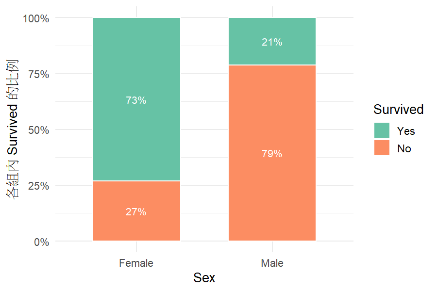

```{r}
#| include: false
library(jsonlite)
skill_dir <- "categorical-association"
for (f in list.files(file.path(skill_dir, "R"), pattern = "\\.R$", full.names = TRUE)) source(f)

# Run the Skill's own runner, exactly as Claude would.
run_skill <- function(spec, out = tempfile("run-"), data = "dev/demo/student_por.csv") {
  spec_file <- tempfile(fileext = ".json")
  writeLines(toJSON(spec, auto_unbox = TRUE, null = "null"), spec_file, useBytes = TRUE)
  status <- system2("Rscript", c(shQuote(file.path(skill_dir, "scripts", "run_analysis.R")),
                                 shQuote(data), shQuote(spec_file), shQuote(out)),
                    stdout = FALSE, stderr = FALSE)
  list(status = status, out = out, json = fromJSON(file.path(out, "result.json")))
}
ok <- function(x) if (isTRUE(x)) "✅" else "❌"
```

::: {.callout-tip}
## 這一頁要回答
1. 這個 Skill **要解決什麼問題**？
2. 它**怎麼設計**的？為什麼這樣設計？
3. **怎麼用**？
4. 做出來的結果**合不合理**？我們怎麼確認？
:::

## Skill 要解決什麼問題？

拿到一份資料、想知道「A 和 B 有沒有關係」，真正困難的不是按下卡方檢定，而是**前面的判斷**：

- 這個變數是名目還是有序？數字 1–4 是代碼還是分數？
- 每一列彼此獨立嗎？同一個人有沒有出現兩次？
- 樣本夠不夠大？要不要控制別的變數？

直接問一般的 AI，它常常**直接套卡方、自己心算數字**，而且不會提醒限制。我們的目標：

::: {.callout-note}
## 目標
做一個 Skill，讓 Claude 像修過類別資料分析的助教：**先判斷、和使用者確認、再用 R 算，最後用白話解釋並提醒限制**。範圍是「兩個類別變數的關聯」（教科書第 1–2 章）。
:::

## 什麼是 Skill？

Skill 是一個資料夾，裡面的 `SKILL.md` 告訴 Claude「遇到這類問題時該怎麼做」，其他檔案（參考資料、程式）**需要時才讀**，不會一開始就塞滿對話。

```{r}
#| echo: false
#| comment: ""
files <- list.files(skill_dir, recursive = TRUE)
files <- files[!grepl("__pycache__", files)]
desc <- c("SKILL.md" = "主要指示：規則、五個階段、輸出用語",
          "references/checklist.md" = "注意事項清單：我們的統計知識（階段 3 判斷用）",
          "references/decision-tree.md" = "選方法的決策樹",
          "references/methods.md" = "方法速查＋給沒有 R 的使用者的程式碼",
          "references/textbook-methods.md" = "教科書公式、節號、警告代碼（被追問時才讀）",
          "scripts/profile_data.R" = "階段 1：資料總覽、判斷變數型態與資料結構",
          "scripts/profile_data.py" = "階段 1 的 Python 版（網頁版用）",
          "scripts/describe_question.R" = "階段 2：依問題畫圖、算判斷要用的數字",
          "scripts/describe_question.py" = "階段 2 的 Python 版（網頁版用）",
          "scripts/cda_describe.py" = "Python 版的共用程式",
          "scripts/run_analysis.R" = "階段 4：計算、畫圖、產生報告",
          "scripts/load_engine.R" = "載入計算引擎",
          "scripts/install_packages.R" = "安裝 R 套件",
          "R/association.R" = "計算引擎：列聯表、趨勢檢定、分層分析",
          "R/describe.R" = "計算引擎：總覽表、問題的初步檢視",
          "R/profile.R" = "計算引擎：猜變數型態",
          "R/plots.R" = "計算引擎：畫圖",
          "R/utils.R" = "計算引擎：讀檔、recode、輸出 JSON")
cat(sprintf("categorical-association/%-34s %s", files, desc[files]), sep = "\n")
```

`SKILL.md` 開頭的 `description` 決定 Claude **什麼時候**會使用這個 Skill：

```{r}
#| echo: false
#| comment: ""
cat(readLines(file.path(skill_dir, "SKILL.md"), encoding = "UTF-8")[1:4], sep = "\n")
```

## 設計：五個原則

::: {.callout-important}
## 1. AI 判斷，R 計算
Claude **不可以自己算任何數字**。它只負責理解問題、判斷變數、選方法、解釋；所有統計量都由 R 程式計算，結果寫成 `result.json` 和報告檔，Claude 只能引用。
:::

為什麼？語言模型「看起來會算」，但數字可能是編的。分工後，**數字的正確性可以用測試證明**，不用相信 AI。

::: {.callout-important}
## 2. 先看資料、判斷適不適合，停下來等使用者 OK
變數型態、資料是否獨立，**資料本身證明不了**，只有使用者知道。所以 Skill 先給資料總覽、問使用者想問什麼、畫圖，再對每個候選方法標示 ✅ 適合／⚠️ 可以做但有問題／❌ 不適合，**停下來等使用者確認**，才開始算。
:::

::: {.callout-important}
## 3. 範圍外就轉介，不硬算
多個解釋變數 → 組員的類別模型 Skill；配對、重複測量 → 組員的相關資料 Skill；結果是連續數值 → 不是類別分析。**寧可說「這裡不能做」，也不要用錯方法給出看似合理的數字。**
:::

::: {.callout-important}
## 4. 每個警告都有依據
Skill 會自動提出警告（期望次數太小、勝算比不是相對風險、Simpson 悖論…），每一條都對應到教科書的段落，不是 AI 自己想的。
:::

::: {.callout-important}
## 5. 判斷的依據是我們的知識，不是 AI 臨場發揮
「這份資料適不適合用這個方法」由 `references/checklist.md` 決定。這份清單整理了**統計人看到資料時會先停下來想一想的狀況**，清單上沒有的，Skill 不可以自己發明標準。
:::

## 我們的知識：注意事項清單

老師要求 Skill 要有我們自己的知識。我們把「統計人碰到什麼狀況，需要請 AI 注意」整理成 16 條，每一條寫三件事：**狀況、為什麼要注意、標示與做法**，並註明 Skill 能不能自動判斷。

```{r}
#| include: false
ck <- readLines(file.path(skill_dir, "references", "checklist.md"), encoding = "UTF-8")
section_of <- cumsum(grepl("^## [ABC]\\.", ck))
items <- grepl("^### [0-9]+\\.", ck)
by_cat <- tapply(items, section_of, sum)[-1]
mvp <- ck[(grep("^## MVP", ck) + 1):length(ck)]
mvp <- mvp[nzchar(mvp)]
```

| 類別 | 條數 | 例子 |
|---|---|---|
| A. Skill 可以自動從資料檢查 | `r by_cat[1]` | 期望次數太小（Cochran 準則）、有 0 次數的格子、缺失值、各層勝算比方向不一致 |
| B. 需要向使用者確認才能判斷 | `r by_cat[2]` | 重複觀察、叢集資料、數字代碼是否有順序、研究設計、第三個變數的角色 |
| C. 結果解釋的提醒 | `r by_cat[3]` | P 值不等於關聯強弱、相關不等於因果、勝算比不是機率的倍數 |

每一條都標註「Skill 是否能自動判斷：Yes／Partial／No」。例如期望次數是 **Yes**（直接從資料算）；重複觀察是 **Partial**（能偵測可疑欄位，但一定要問）；研究設計是 **No**（資料看不出來）。

第一版真正實作的核心 guardrails 有 9 條，其餘只做文字提醒，避免第一版過於複雜：

```{r}
#| echo: false
#| results: asis
cat(mvp, sep = "\n")
```

::: {.callout-note}
## 清單是怎麼寫出來的
主題由組員決定（資料結構、樣本大小、變數型態、研究設計、第三個變數、結果解釋）。AI 依主題起草文字後，組員逐條修正判斷規則，例如：

- 不能只用「總樣本數小於多少」判斷，要看期望次數與表格稀疏程度。
- 小組人數 < 10、缺失 ≥ 5% 只是**提醒**，不是不能分析的界線。
- 各層勝算比「差很多」不設任意倍率門檻，只在方向相反或同質性檢定顯著時標 ⚠️。
- 趨勢檢定分成 Cochran–Armitage（二元結果 × 有序）與 linear-by-linear association（有序 × 有序），名稱不混用；性別 × 滿意度這種二元名目 × 有序，第一版不做。
- 第一版只報 Fisher 精確檢定，不報 mid-P，避免同時給好幾種 P 值。
:::

### 整個流程

```{mermaid}
flowchart LR
    U[使用者：資料] --> P1[階段 1<br/>資料總覽<br/>敘述統計總表]
    P1 --> Q{{停：問使用者<br/>想問什麼}}
    Q --> P2[階段 2<br/>依問題畫圖<br/>長條圖、關係圖]
    P2 --> P3[階段 3<br/>對照注意事項清單<br/>✅ ⚠️ ❌]
    P3 --> STOP{{停：等使用者 OK}}
    STOP --> P4[階段 4<br/>R 計算＋畫圖＋報告]
    P4 --> P5[階段 5<br/>白話解釋<br/>補進報告檔]
```

Claude 和程式之間只透過**檔案**溝通：

| 檔案 | 誰寫 | 內容 |
|---|---|---|
| `profile.json`、`資料總覽_*.md` | 程式（階段 1） | 每個變數的型態猜測、次數、缺失；資料結構的提示 |
| `question.json` | Claude（階段 2） | 使用者的問題用到哪些變數 |
| `check.json`、`初步檢視_*.md` | 程式（階段 2） | 階段 3 判斷要用的數字：樣本數、最小組、期望次數、0 次數格子、各層人數 |
| `spec.json` | Claude（階段 4） | 使用者的問題、變數型態、資料結構、選的方法與理由：**判斷紀錄** |
| `result.json` | R（階段 4） | 所有數字、固定句型的結論、警告：**計算結果** |

`spec.json` 讓我們事後可以檢查 Claude 的判斷對不對；`result.json` 讓 Claude 不用（也不能）自己算。

### 兩種模式

| | 模式 1：有 R | 模式 2：沒有 R |
|---|---|---|
| 環境 | Claude Code、本機 | claude.ai 網頁版（實測有 Python：pandas 2.3.3、matplotlib 3.10.8，沒有 R） |
| 階段 1–2：總表、圖 | R 程式 | **Python 版**，和 R 版輸出相同（自動測試逐項比對） |
| 階段 3：判斷 | Skill 自動完成 | Skill 自動完成 |
| 階段 4：統計檢定 | Claude 執行 R 程式 | Claude 給改好欄位名稱的 **R 程式碼**，使用者自己執行後貼回 |
| 階段 5：解釋 | 依 `result.json` | 依使用者貼回的輸出 |

為什麼網頁版不全部改用 Python？敘述統計和畫圖只是計數，兩種語言不會算出不同結果；統計檢定（例如信賴區間的算法）兩邊的預設方法不一定相同，所以**檢定只保留 R 一套**。

## 怎麼用？

### 安裝（Claude Code，Windows）

需求：R（`Rscript` 要在 PATH 中）。

1. 下載 `categorical-association.zip` 並解壓縮。
2. 安裝 R 套件：`Rscript categorical-association/scripts/install_packages.R`
3. 把 `categorical-association` 資料夾複製到 `C:\Users\<使用者名稱>\.claude\skills\`（沒有 `skills` 資料夾就自己建立）。
4. 在 `C:\Users\<使用者名稱>\.claude\settings.json` 的 `permissions.allow` 加入 `"Bash(Rscript *)"` 與 `"PowerShell(Rscript *)"`，免得每一步都要按允許。
5. 在資料所在的資料夾啟動 Claude Code，輸入 `/categorical-association`，或直接用自然語言發問。

claude.ai 網頁版：在「設定 → 功能」開啟程式碼執行，再到「Skills」上傳 zip。第 1–2 步會用 Python 自動跑；第 4 步 Claude 會給你 R 程式碼，你在 RStudio 執行後把結果貼回去（模式 2）。

### 上台示範：三份示範資料

`example_data/` 裡有三份公開資料，各對應一種分析。示範時把一份資料放進一個空資料夾，在那裡啟動 Claude Code，照下表輸入和回答。

```{r}
#| include: false
lv3 <- c("Low", "Medium", "High")
demo_runs <- list(
  titanic = run_skill(list(question = "鐵達尼號上女性的存活率比男性高嗎？", structure = "independent",
                           types = list(Sex = "binary", Survived = "binary"), method_id = "crosstab",
                           reason = "兩個二元變數、一人一列，用列聯表與卡方檢定（§2.4）",
                           analysis = "crosstab", x = "Sex", y = "Survived", success = "Yes", design = "cross-sectional",
                           levels = list(Sex = c("Female", "Male"), Survived = c("Yes", "No"))),
                      data = "example_data/01_crosstab_titanic.csv"),
  housing = run_skill(list(question = "住戶對管理的影響力越大，居住滿意度越高嗎？", structure = "independent",
                           types = list(Infl = "ordinal", Sat = "ordinal"), method_id = "trend",
                           reason = "兩個有序變數，用 linear-by-linear association 檢定（§2.5.1）",
                           analysis = "trend", x = "Infl", y = "Sat", count = "Freq", ordinal = list("Infl", "Sat"),
                           design = "cross-sectional", levels = list(Infl = lv3, Sat = lv3)),
                      out = "dev/demo/example-output", data = "example_data/02_trend_housing.csv"),
  berkeley = run_skill(list(question = "柏克萊研究所錄取有性別差異嗎？控制科系之後呢？", structure = "independent",
                            types = list(Gender = "binary", Admit = "binary", Dept = "nominal"), method_id = "stratified",
                            reason = "要控制科系，用分層分析與 CMH 檢定（§2.7）",
                            analysis = "stratified", x = "Gender", y = "Admit", z = "Dept", count = "Freq",
                            success = "Admitted", design = "cross-sectional",
                            levels = list(Gender = c("Male", "Female"), Admit = c("Admitted", "Rejected"))),
                       data = "example_data/03_stratified_berkeley.csv"))
st <- function(r, t) r$json$tests$statistic[r$json$tests$test == t]
es <- function(r, m) r$json$estimates$estimate[r$json$estimates$measure == m]
f2 <- function(x) formatC(x, format = "f", digits = 2)
f3 <- function(x) formatC(x, format = "f", digits = 3)
report <- readLines(list.files(demo_runs$housing$out, pattern = "\\.md$", full.names = TRUE), encoding = "UTF-8")
codes <- function(r) paste(r$json$warnings$code, collapse = "、")

# Stages 1-2 on the Titanic data, exactly as Claude runs them.
stage_dir <- "dev/demo/example-output/stages-1-2"
system2("Rscript", c(shQuote(file.path(skill_dir, "scripts", "profile_data.R")),
                     shQuote("example_data/01_crosstab_titanic.csv"), shQuote(stage_dir)), stdout = FALSE, stderr = FALSE)
q_file <- tempfile(fileext = ".json")
writeLines('{"x": "Sex", "y": "Survived", "levels": {"Survived": ["Yes", "No"]}}', q_file)
system2("Rscript", c(shQuote(file.path(skill_dir, "scripts", "describe_question.R")),
                     shQuote("example_data/01_crosstab_titanic.csv"), shQuote(q_file), shQuote(stage_dir)),
        stdout = FALSE, stderr = FALSE)
overview <- readLines(file.path(stage_dir, "資料總覽_01_crosstab_titanic.md"), encoding = "UTF-8")
check <- readLines(file.path(stage_dir, "初步檢視_01_crosstab_titanic.md"), encoding = "UTF-8")
```

| 資料 | 輸入的問題 | Skill 停下來問時，這樣回答 | 預期結果 |
|---|---|---|---|
| `01_crosstab_titanic.csv`<br/>鐵達尼號 2201 位乘客，一人一列 | 鐵達尼號上女性的存活率比男性高嗎？ | 每一列是不同的乘客；成功 = 存活（Yes）；用推薦的 | X² = `r f2(st(demo_runs$titanic, "Pearson X2"))`；存活率差 `r f2(es(demo_runs$titanic, "difference of proportions"))`、相對風險 `r f2(es(demo_runs$titanic, "relative risk"))`、勝算比 `r f2(es(demo_runs$titanic, "odds ratio"))` |
| `02_trend_housing.csv`<br/>哥本哈根 1681 戶住戶，次數表 | 住戶對管理的影響力越大，居住滿意度越高嗎？ | 兩個都是有序（Low < Medium < High）；**不是配對**，是同一戶回答的兩個不同問題；用推薦的 | Linear-by-linear association：M² = `r f2(st(demo_runs$housing, "Linear-by-linear association (M2)"))`（df = 1），對照忽略順序的 X² = `r f2(st(demo_runs$housing, "Pearson X2 (ignores order)"))`（df = 4） |
| `03_stratified_berkeley.csv`<br/>柏克萊研究所 4526 位申請者，6 個科系 | 柏克萊研究所錄取有性別差異嗎？控制科系之後呢？ | 每一列是一群不同的申請者；成功 = 錄取（Admitted）；用推薦的 | 合併看勝算比 `r f2(es(demo_runs$berkeley, "marginal odds ratio"))`（男生較易錄取）；控制科系後共同勝算比 `r f2(es(demo_runs$berkeley, "common odds ratio (logistic model)"))`、CMH 的 P = `r f3(demo_runs$berkeley$json$tests$p_value[grepl("Mantel", demo_runs$berkeley$json$tests$test)])` |

::: {.callout-tip}
## 三份資料各自要讓台下看到什麼
- **鐵達尼號**：一人一列的原始資料；Skill 自己數出列聯表，並提醒「勝算比 10 不是存活機率的 10 倍」。
- **住戶滿意度**：Skill 會**懷疑兩欄是配對資料**（因為兩欄的類別都是 Low/Medium/High），停下來問。這正好示範「資料證明不了的事要問人」。回答之後，它用 **linear-by-linear association 檢定**（兩個都有序），並說明為什麼比卡方更有力。
- **柏克萊錄取**：合併來看男生比較容易錄取，分科系後差異幾乎消失，因為女生多申請錄取率低的科系。Skill 會提出 `r codes(demo_runs$berkeley)`：各科系勝算比方向不一致、同質性檢定 P = `r f3(demo_runs$berkeley$json$tests$p_value[grepl("Homogeneous", demo_runs$berkeley$json$tests$test)])`，所以要逐科系報告，不能只報共同勝算比。
:::

### 階段 1–2 實際長什麼樣子（鐵達尼號）

階段 1 只給一張總表，不畫圖：

::: {.callout-note collapse="true"}
## 資料總覽（點開查看）
```{r}
#| echo: false
#| results: asis
cat(sub("^#", "####", overview), sep = "\n")
```
:::

使用者說出問題（性別和存活）之後，階段 2 畫出相關變數的圖，並算出階段 3 要用的數字：

```{r}
#| echo: false
#| results: asis
cat(grep("^- ", check, value = TRUE), sep = "\n")
```



Skill 停下來確認時的畫面（實測截圖，用的是第二層驗證的學生資料，當時是改版前的流程）：


確認之後，R 計算並自動產生報告。以住戶滿意度為例：

::: {.callout-note collapse="true"}
## R 產生的報告檔（點開查看）
```{r}
#| echo: false
#| results: asis
cat(sub("^#", "####", grep("^!\\[", report, value = TRUE, invert = TRUE)), sep = "\n")
```
:::


Claude 再把白話結論補在報告最前面。

## 合不合理？三層驗證

我們用三種方式檢查 Skill，**每一種都不靠 AI 自己說「我是對的」**。

### 第一層：數字和教科書一致

用教科書的例子跑計算引擎，每個數字都要和課本印的一樣：

```{r}
#| include: false
res <- as.data.frame(testthat::test_file("dev/tests/test-association.R", reporter = "silent"))
```

```{r}
#| echo: false
labels <- c(
  "§2.4 party ID by gender (Table 2.4): X², G², standardized residuals" = "課本｜性別×政黨認同：X²、G²、標準化殘差",
  "§2.2–2.3 aspirin and heart attacks (Table 2.2): score CIs" = "課本｜阿斯匹靈與心肌梗塞：比例差、相對風險、勝算比的 score 信賴區間",
  "§2.6 tea tasting (Table 2.7): Fisher only (no mid-P in v1), small-sample warning" = "課本｜品茶實驗：Fisher 精確檢定（不報 mid-P）、期望次數警告",
  "§2.3.5 case-control design suppresses difference and relative risk" = "課本｜case-control 研究：只報告勝算比",
  "§2.5.2 alcohol and malformation (Table 2.6): Cochran-Armitage M² with midpoint scores" = "課本｜懷孕飲酒與畸形：Cochran–Armitage M²、分數敏感度",
  "§2.5.5 Cochran-Armitage refuses an explanatory variable not confirmed as ordinal" = "清單 10｜沒確認有序的變數不能做 Cochran–Armitage",
  "trend: ordinal × ordinal is linear-by-linear; binary nominal x × ordinal y is refused" = "清單 10｜有序×有序叫 linear-by-linear；性別×滿意度不做趨勢檢定",
  "Cochran's rule: larger tables warn only for expected < 1 or > 20% of cells below 5" = "清單 1｜Cochran 準則：大表只在 < 1 或超過 20% 的格子 < 5 時警告",
  "§2.7 death penalty (Table 2.9): conditional/marginal ORs, Simpson, logistic" = "課本｜死刑判決：條件／邊際勝算比、Simpson 悖論、CMH",
  "missing values: always reported; warning at >= 5%, stronger at >= 20%" = "清單 5｜缺失一律報告；≥ 5% 提醒、≥ 20% 加強提醒",
  "an empty category is removed and reported; zero cells are named" = "清單 2｜空類別移除並告知；指出哪一格是 0、不加 0.5",
  "strata: opposite directions and significant homogeneity are flagged; CIs listed" = "清單 7｜各層方向不一致、同質性顯著時警告，並列出各層 CI",
  "strata: same direction in every stratum gives no OPPOSITE_DIRECTIONS" = "清單 7｜各層方向一致時不誤報",
  "small groups get a stability reminder (text only), not a refusal" = "清單 3｜小組人數只提醒，不拒絕分析")
knitr::kable(data.frame(
  測試 = ifelse(res$test %in% names(labels), labels[res$test], res$test),
  檢查項目數 = res$nb, 通過 = ifelse(res$failed == 0 & !res$error, "✅", "❌"), row.names = NULL))
```

「課本」是用教科書的例子對答案，例如政黨×性別 X² = 12.57、飲酒與畸形 M² = 6.57、死刑判決的條件勝算比 0.43 和邊際勝算比 1.45，都和課本相同。「清單」是檢查注意事項清單的規則有沒有照我們訂的方式運作。

### 第二層：真實資料，人為判斷 vs Skill 判斷

用公開的葡萄牙高中生資料（649 人）問三個問題。流程刻意分開，避免「自己改自己的考卷」：

1. **我們先自己判斷**每一題的方法（寫在 `dev/demo/judgment.yml`），才去問 Skill
2. 在**另一個乾淨的資料夾、全新的對話**裡使用 Skill，它看不到我們的答案
3. 另寫一支**不使用 Skill 程式碼**的驗證程式（`dev/demo/verify.R`，只用 R 內建函式）重算數字

```{r}
#| include: false
judg <- yaml::read_yaml("dev/demo/judgment.yml")$questions
specs <- lapply(c("q1", "q2", "q3"), function(q) fromJSON(file.path("dev/demo/skill", q, "spec.json")))
cmp <- do.call(rbind, Map(function(j, s) {
  var_types <- c(j$variables$outcome, j$variables$explanatory)
  data.frame(
    問題 = j$question,
    資料結構 = paste(j$judgment$structure, ok(j$judgment$structure == s$structure)),
    變數型態 = paste(j$judgment$explanatory_type, "×", j$judgment$outcome_type,
                 ok(s$types[[j$variables$explanatory]] == j$judgment$explanatory_type &&
                    s$types[[j$variables$outcome]] == j$judgment$outcome_type)),
    方法 = paste(j$judgment$method, ok(j$judgment$method_id == s$method_id)))
}, judg, specs))
```

```{r}
#| echo: false
knitr::kable(cmp, caption = "人為判斷（表中文字）與 Skill 的判斷是否一致")
```

數字的比對：Skill 的結果 vs 獨立驗證程式。

```{r}
#| include: false
v <- fromJSON("dev/demo/verify_results.json")
sk <- lapply(c("q1", "q2", "q3"), function(q) fromJSON(file.path("dev/demo/skill", q, "result.json")))
est <- function(r, m) r$estimates$estimate[r$estimates$measure == m]
tst <- function(r, t) r$tests$statistic[r$tests$test == t]
nums <- data.frame(
  問題 = c("交往×及格", "", "", "讀書時間×及格", "", "控制學校", "", ""),
  數字 = c("卡方 X²", "勝算比", "比例差", "M²（中點分數）", "卡方 X²（對照）", "邊際勝算比", "共同勝算比", "LR 檢定"),
  Skill = c(tst(sk[[1]], "Pearson X2"), est(sk[[1]], "odds ratio"), est(sk[[1]], "difference of proportions"),
            tst(sk[[2]], "M2 linear trend"), tst(sk[[2]], "Pearson X2 (ignores order)"),   # name used by v1
            est(sk[[3]], "marginal odds ratio"), est(sk[[3]], "common odds ratio (logistic model)"),
            sk[[3]]$tests$statistic[grepl("^LR", sk[[3]]$tests$test)]),
  驗證程式 = c(v$q1$X2, v$q1$or, v$q1$diff, v$q2$M2_mid, v$q2$X2, v$q3$marginal_or, v$q3$common_or, v$q3$LR))
# The real-data test ran the Skill before it was split into per-member Skills.
# Re-run the same spec.json files through this Skill to show the numbers did not change.
re <- lapply(c("q1", "q2", "q3"), function(q) run_skill(fromJSON(file.path("dev/demo/skill", q, "spec.json")))$json)
nums$新版重跑 <- c(tst(re[[1]], "Pearson X2"), est(re[[1]], "odds ratio"), est(re[[1]], "difference of proportions"),
                tst(re[[2]], "Cochran-Armitage trend (M2)"), tst(re[[2]], "Pearson X2 (ignores order)"),
                est(re[[3]], "marginal odds ratio"), est(re[[3]], "common odds ratio (logistic model)"),
                re[[3]]$tests$statistic[grepl("^LR", re[[3]]$tests$test)])
nums$一致 <- ifelse(abs(nums$Skill - nums$驗證程式) < 1e-4 & abs(nums$新版重跑 - nums$驗證程式) < 1e-4, "✅", "❌")
nums$新版重跑 <- round(nums$新版重跑, 4)
nums$Skill <- round(nums$Skill, 4); nums$驗證程式 <- round(nums$驗證程式, 4)
```

```{r}
#| echo: false
knitr::kable(nums)
```

實測時用的是全組共用、尚未拆分的 Skill 版本；拆成個人 Skill、加入注意事項清單後，用同樣的 `spec.json` 重跑（「新版重跑」欄），數字完全相同。讀書時間×及格的趨勢檢定，新版的正式名稱是 Cochran–Armitage 趨勢檢定（及格是二元結果）。

::: {.callout-note collapse="true"}
## 比例差為什麼是負的？（點開查看）
比例差是「第一列 − 第二列」。第一列是「有交往」，及格率 80.8%，比沒交往的 86.8% 低，所以是負的：有交往的學生及格率低了約 6 個百分點。
:::

::: {.callout-warning}
## 實測中發現：我們自己的判斷也會錯
一開始我們三題都判斷成「卡方檢定」。和 Claude 討論時，它沒有直接給答案，而是指出「讀書時間有 4 個有順序的類別」「題目要求控制學校」，我們回頭查課本後才改成趨勢檢定和分層分析。**Skill 的價值之一，是讓人不會漏掉這些判斷。**
:::

### 第三層：知道什麼時候不能做

```{r}
#| include: false
guards <- list(
  list(情境 = "要求做 logistic 迴歸（超出範圍）", spec = list(analysis = "logistic", y = "pass", x = list("sex"))),
  list(情境 = "名目變數（母親職業，5 類）做趨勢檢定", spec = list(analysis = "trend", x = "Mjob", y = "pass", success = "pass")),
  list(情境 = "性別（二元名目）× 讀書時間（有序）做趨勢檢定", spec = list(analysis = "trend", x = "sex", y = "studytime",
                                                               ordinal = list("studytime"))),
  list(情境 = "欄位名稱打錯", spec = list(analysis = "crosstab", x = "romance", y = "pass")))
guard_tab <- do.call(rbind, lapply(guards, function(g) {
  r <- run_skill(g$spec)
  data.frame(情境 = g$情境, 結果 = if (r$status == 0) "❌ 照算了" else "✅ 拒絕",
             Skill的說明 = substr(gsub("\\s+", " ", r$json$error), 1, 90))
}))
```

```{r}
#| echo: false
knitr::kable(guard_tab)
```

除了程式擋下來的情況，`SKILL.md` 也規定：使用者**指定了不適合的方法**（例如前後測資料要做卡方）時不照做，而是說明原因並建議正確方法；資料**不獨立**、要**多個解釋變數**時，轉介組員的 Skill。

### 自動測試總結

```{r}
#| include: false
all <- as.data.frame(testthat::test_dir("dev/tests", reporter = "silent", stop_on_failure = FALSE))
```

`dev/tests/` 裡共 `r nrow(all)` 組測試、`r sum(all$nb)` 個檢查項目，**全部通過：`r ok(all(all$failed == 0 & !all$error))`**（包含：課本對照、注意事項清單的規則、資料判斷、recode、端對端執行、模式 2 程式碼和引擎結果一致、Python 版和 R 版的總表與檢查數字逐項一致）。每次修改 Skill 都重跑一次。

## 開發過程：AI 怎麼幫忙、我們怎麼決定

整個 Skill 是和 Claude Code 一起開發的。每一步都記錄「我們要求什麼、AI 建議什麼、我們怎麼決定、怎麼驗證」（`dev/ai-log/log.csv`）。

| 階段 | 我們的要求 | AI 的建議 | 我們的決定 |
|---|---|---|---|
| 規劃 | 以 Agresti 課本為依據，規劃 Skill 的最低功能 | 「AI 判斷、程式計算」；計算用 Python、R 只做驗證 | **拒絕 Python**：改以 R 為主，和課本一致 |
| 實作 | 完成列聯表分析 | 卡方、Fisher、勝算比；Wald 信賴區間 | 依課本改用 **score 信賴區間**和 mid-P |
| 實作 | 讓 Skill 自己判斷變數型態 | 用欄位名稱、類別數猜型態 | 採用，但**一律要使用者確認** |
| 實作 | 加入趨勢檢定、分層分析 | 加入 M²、Simpson 偵測 | AI 自己發現並修正：二元結果的分數方向和課本相反 |
| 選資料 | 找公開真實資料 | 推薦 UCI 學生資料（CC BY 4.0） | 採用；發現原作者配對有重複，**只留能唯一配對的學生** |
| 實測 | 用新對話測試 Skill | — | 第一次測試時受測的 Claude 讀到了我們的答案檔 → **作廢**，改在乾淨資料夾重測 |
| 拆分 | 老師要每人做一個 Skill | 從全組共用的大 Skill 拆出 Part 1 | 新增：沒有 R 時的模式 2、自動產生報告檔、決策樹 |
| 流程 | 老師要 Skill 有自己的架構 | 列出流程選項讓組員選 | **組員設計流程**：先給總表、問想問什麼、畫圖、判斷適不適合（三級標示），OK 後才分析 |
| 知識 | 老師要 Skill 有我們的知識 | 依組員訂的主題起草注意事項 | **組員逐條修正規則**（期望次數、0 格、缺失、各層勝算比、趨勢檢定命名），訂出 MVP 9 條 |
| 網頁版 | 網頁版沒有 R，第 1–2 步怎麼辦 | 三個做法：Python 只做總表與圖／全部 Python／全部給 R 程式碼 | **只有總表與圖用 Python**，檢定仍只用 R；先在網頁版實測確認有 pandas、matplotlib |
| 簡化 | 避免使用者被多種 P 值混淆 | — | 組員決定第一版**不報 mid-P**，只在方法頁當延伸知識 |

## 遇到的問題與修正

| 問題 | 怎麼發現 | 修正 |
|---|---|---|
| 趨勢檢定的方向和課本相反 | 對照課本的 M = 2.56 時正負號不對 | 二元結果改為「成功 = 1」 |
| 樣本勝算比無限大時，JSON 寫成 `null`，看起來像缺失值 | 測試 0 次數的格子 | 改寫成 `"Inf"`，並在 SKILL.md 說明 |
| 兩個無關的 0/1 欄位被誤判成配對資料 | 用自製情境測試 | 配對判斷要求欄位名稱相似、類別相同 |
| 只有 2 組的 `group` 欄被當成叢集 | 同上 | 叢集至少要 5 個群組 |
| 受測的 Claude 先讀到了人為判斷檔 | 它自己停下來回報 | 測試改在 repo 外的乾淨資料夾、新對話進行 |
| 參考資料的節號有幾處引錯 | 寫 `textbook-methods.md` 時用課本目錄逐條核對 | 修正為正確段落；課本沒有給公式的地方明確標註 |
| 使用者要求錯誤方法時，Skill 可能照做 | 設計防呆題目時發現 SKILL.md 沒規定 | 加上規則：不適合就不照做，說明並建議正確方法 |
| 類別排序隨電腦而不同（Windows 把 `<1` 排在 `0` 前面） | 比對 Python 版和 R 版的總表 | 兩邊都改成依字元編碼排序 |
| Python 版的長條圖沒照 recode 設定的類別順序 | 看圖時發現「多、少」順序相反 | 改成照使用者設定的順序 |
| 只有一個欄位時，R 的 JSON 寫成字串、Python 寫成清單 | 同上 | 統一寫成清單 |
| 測試資料自己寫錯（以為只有一格期望次數 < 5） | Cochran 準則的測試失敗 | 重新計算期望次數，改正測試資料；程式本身是對的 |

## 限制與下一步

::: {.callout-warning}
## 限制
- 變數型態的猜測是**經驗規則**（欄位名稱、類別數），一定要使用者確認
- 只做兩個類別變數（最多再控制一個二元×二元的分層變數）
- 判斷再好，資料**是否獨立**仍取決於使用者對資料的了解
- 真實資料實測只有一份資料、三個問題，而且是在加入注意事項清單、改成五階段流程**之前**做的
- 注意事項清單的門檻（小組 10 人、缺失 5%／20%）是提醒標準，不是理論上的界線
- 網頁版沒有中文字型時，Python 版的圖會改用英文座標軸；資料本身的中文類別可能無法顯示
:::

**下一步**：用新版 Skill 在全新對話中重新實測（包含三份示範資料與「陷阱題」：配對資料、性別×滿意度要求趨勢檢定），並把 zip 上傳到網頁版實測模式 2。

## 參考文獻

Agresti, A. (2019). *An Introduction to Categorical Data Analysis* (3rd ed.). Wiley.

Bickel, P. J., Hammel, E. A., & O'Connell, J. W. (1975). Sex bias in graduate admissions: Data from Berkeley. *Science*, 187, 398–404.（R 內建 `UCBAdmissions`）

Dawson, R. J. M. (1995). The "unusual episode" data revisited. *Journal of Statistics Education*, 3(3).（R 內建 `Titanic`）

Madsen, M. (1976). Statistical analysis of multiple contingency tables. Two examples. *Scandinavian Journal of Statistics*, 3, 97–106.（R 套件 MASS 的 `housing`）

Cortez, P. (2008). Student Performance [Dataset]. UCI Machine Learning Repository. <https://doi.org/10.24432/C5TG7T>（CC BY 4.0；我們改成逗號分隔並新增 `pass` 欄）

Doll, R., & Hill, A. B. (1950). Smoking and carcinoma of the lung. *British Medical Journal*, 2(4682), 739–748.（測試用的 case-control 例子）

Fisher, R. A. (1935). *The Design of Experiments*. Oliver & Boyd.（測試用的品茶實驗）

Graubard, B. I., & Korn, E. L. (1987). Choice of column scores for testing independence in ordered 2 × K contingency tables. *Biometrics*, 43, 471–476.（測試用的孕期飲酒與畸形）

Steering Committee of the Physicians' Health Study Research Group (1989). Final report on the aspirin component of the ongoing Physicians' Health Study. *New England Journal of Medicine*, 321, 129–135.（測試用的阿斯匹靈例子）

Venables, W. N., & Ripley, B. D. (2002). *Modern Applied Statistics with S* (4th ed.). Springer.（MASS 套件的 `housing` 資料）

R Core Team (2026). *R: A language and environment for statistical computing*. R Foundation for Statistical Computing.（內建資料 `Titanic`、`UCBAdmissions`）

課本其他例子的資料（政黨×性別、死刑判決等）由作者公開在 <https://github.com/alanagresti/categorical-data>；本 repo 不收錄，測試時才下載。軟體與套件的完整清單見 README。

Cortez, P., & Silva, A. (2008). Using data mining to predict secondary school student performance. *Proceedings of 5th Future Business Technology Conference*, 5–12. UCI Machine Learning Repository. <https://doi.org/10.24432/C5TG7T>
